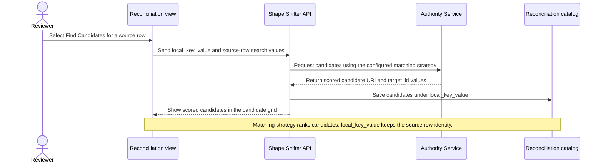
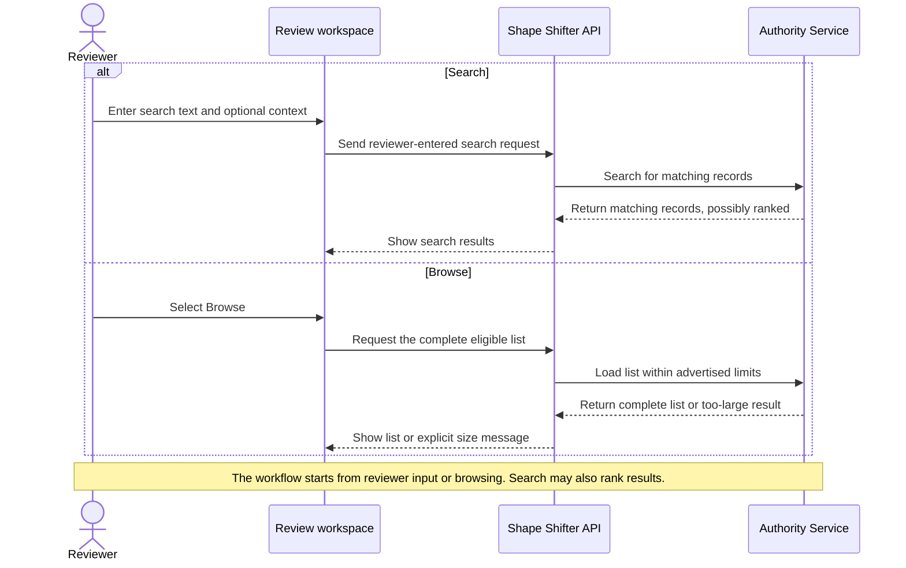
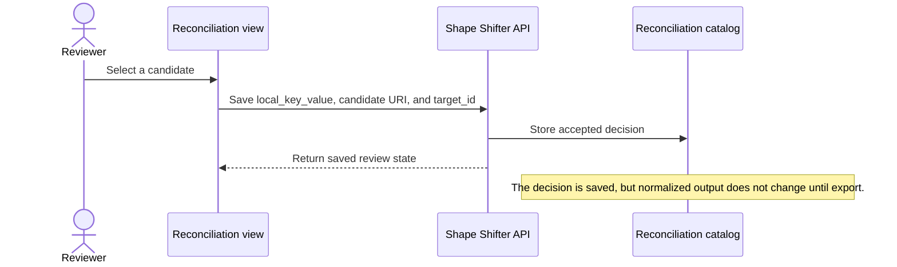
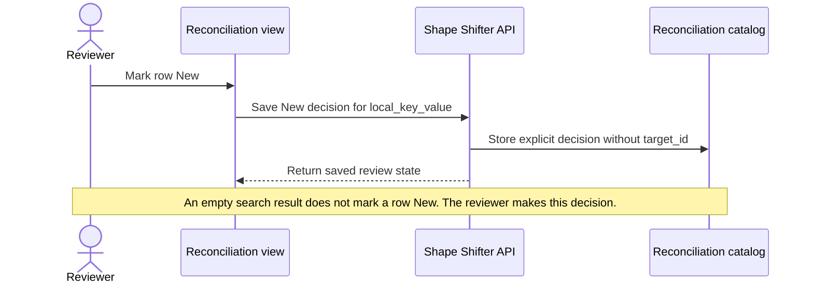
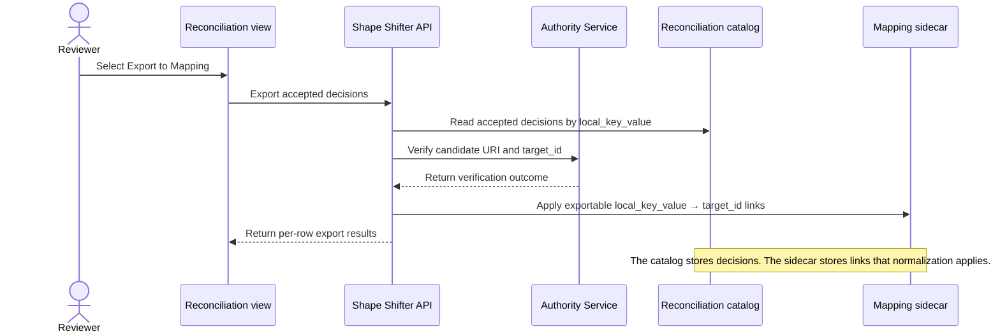
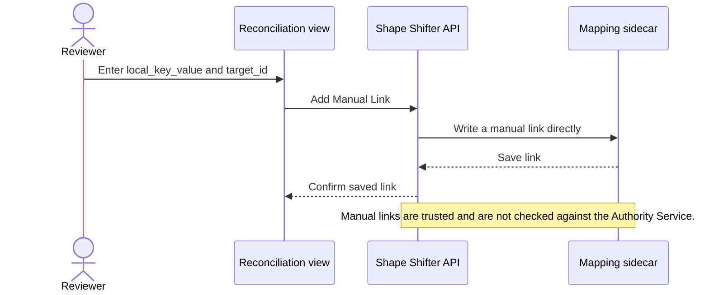
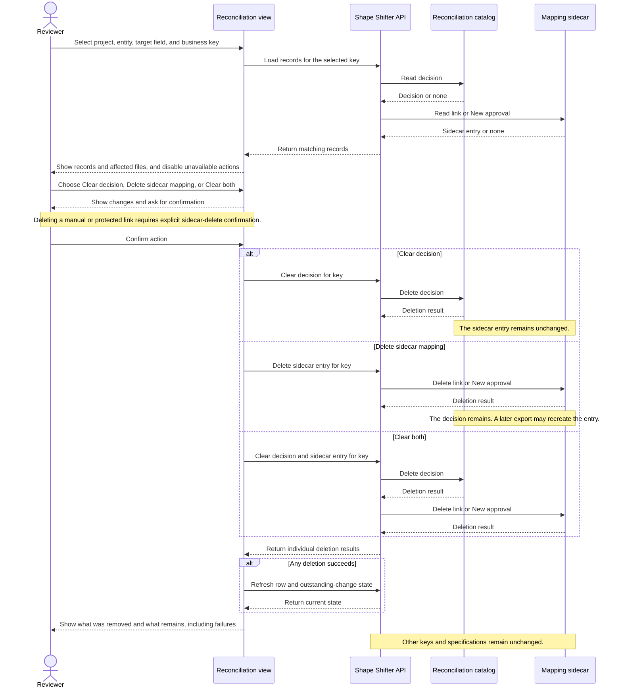
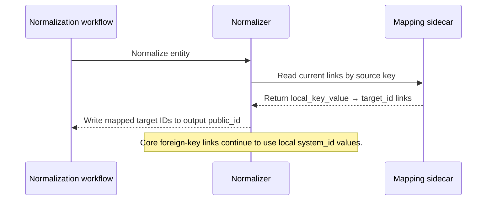

# Reconciliation workflow diagrams

These diagrams show how source-row keys and target-record IDs move through reconciliation. `local_key_value` identifies a source row; `target_id` identifies a record in the target system. The reconciliation catalog stores candidate results from ranked candidate matching and review decisions. The mapping sidecar stores links that normalization applies.

See the [reconciliation improvement backlog](./RECONCILIATION_IMPROVEMENTS_BACKLOG.md) for proposed workflow improvements.

## Ranked candidate matching

## Interactive Search/Browse

## Accept a candidate

## Mark a row New

## Export accepted decisions

## Add a manual link

## Clear a decision or sidecar mapping (R32)

TBD: This diagram describes the proposed R32 workflow, not current behavior.

## Run normalization

