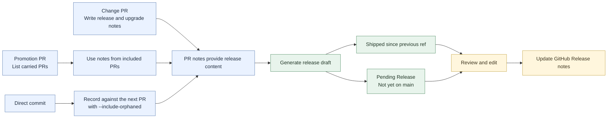

# What's New

This directory is for user-facing release notes.

Unlike `CHANGELOG.md`, the files here should be written for normal users rather than developers. The goal is to explain what changed in terms of visible improvements, workflow changes, and upgrade impact.

Include changes users can see, workflow changes, and required upgrade actions. Leave out internal refactors and test- or maintenance-only work.

Use one file per release. Start from [TEMPLATE.md](TEMPLATE.md), include a short summary, and link to the technical changelog and GitHub release.

## Maintaining Release Notes

Changes reach `main` through `dev`, `staging`, and `main`. A release note covers pull requests present in the current release ref but absent from the previous release ref. The generator reads pull request descriptions, so record direct commits against a following pull request.



1. **Add notes to the change PR.** Complete `User-facing release note` and `Upgrade notes` in [the PR template](../../.github/pull_request_template.md). Use one or two plain-language sentences and the template's exact `None` text when a section does not apply.
2. **List included PRs on promotions.** For `dev` to `staging` or `staging` to `main`, use [the promotion template](../../.github/promotion_pr_template.md), keep its `<!-- promotion-pr -->` marker, and list carried PRs under `Included PRs`. The release generator uses those PRs' notes instead of the promotion's.
3. **Review the release draft.** At release, semantic-release runs `scripts/generate_whats_new.py`. It includes PRs shipped since the previous release and, for the latest version, lists PRs not yet on `main` under `Pending Release`. Check that shipped and pending changes are separate and upgrade actions are clear.

   To generate a draft manually:

   ```bash
   python3 scripts/generate_whats_new.py --version X.Y.Z
   ```

   See [the scripts guide](../../scripts/README.md) for prerequisites and options.

4. **Publish corrections.** Edit `docs/whats-new/vX.Y.Z.md` and update the GitHub Release body with `gh release edit vX.Y.Z --notes-file docs/whats-new/vX.Y.Z.md`.
5. **Refresh pending items when needed.** Rerunning the generator replaces the file. Review and reapply manual edits after regeneration.

## Draft a changelog-based release note

To create a draft and Copilot CLI prompt from `CHANGELOG.md`:

```bash
python3 scripts/prepare_copilot_release_notes.py --version X.Y.Z
```

The prompt uses changelog content, not PR-body notes. Review the result against the merged PRs. See [the scripts guide](../../scripts/README.md) for output paths and options.

## Update a PR description

Draft and publish an individual PR description with:

```bash
.venv/bin/python scripts/update_pr_descriptions.py <pr-number> --draft
.venv/bin/python scripts/update_pr_descriptions.py <pr-number> --publish
```

Review and edit `docs/whats-new/PRs/PR_<number>.txt` between the commands. Publishing replaces the PR's full title and body, so keep any existing text you want to retain. For provider setup, bulk drafting, and other options, see [the scripts guide](../../scripts/README.md).

For a direct commit that should be described with the next PR, add `--include-orphaned` when drafting:

```bash
.venv/bin/python scripts/update_pr_descriptions.py <pr-number> --draft --include-orphaned
```

Review the detected commits and describe any user-visible effect in the PR's `User-facing release note` section. For bulk drafting and cleanup options, see [the scripts guide](../../scripts/README.md).

## Template

Start from [TEMPLATE.md](TEMPLATE.md) when creating a release note by hand.
