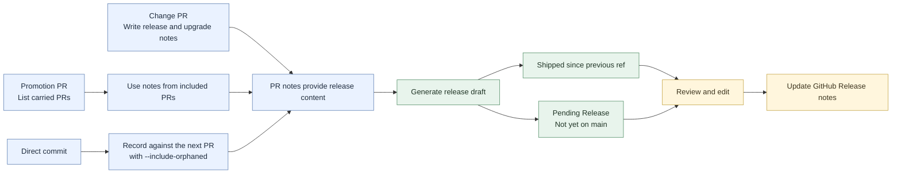

# What's New

This directory is for user-facing release notes.

Unlike `CHANGELOG.md`, the files here should be written for normal users rather than developers. The goal is to explain what changed in terms of visible improvements, workflow changes, and upgrade impact.

## Purpose

Use this directory for:

- concise release summaries
- visible new features
- important bug fixes users may notice
- workflow changes
- upgrade notes or cautions

Do not use this directory for:

- exhaustive engineering history
- commit-by-commit detail
- internal refactors with no user impact
- test or maintenance-only changes

## Recommended Structure

- one file per release or per minor version
- stable naming such as `v1.24.0.md` or `2026-03-v1.24.md`
- a short summary at the top
- links to the technical changelog and GitHub release

## Maintaining Release Notes

Changes reach `main` through `dev`, `staging`, and `main`. A release note covers pull requests present in the current release ref but absent from the previous release ref. The generator reads pull request descriptions, so record direct commits against a following pull request.



1. **Write notes on the change PR.** Complete `User-facing release note` and `Upgrade notes` in [the PR template](../../.github/pull_request_template.md). Use one or two plain-language sentences. Use the template's exact `None` text when there is no user-visible change or upgrade action.
2. **List changes on promotion PRs.** For `dev` to `staging` or `staging` to `main`, use [the promotion template](../../.github/promotion_pr_template.md), keep its `<!-- promotion-pr -->` marker, and list carried PRs under `Included PRs`. Use the `None` fallbacks for the promotion's own notes; the generator reads notes from the included PRs.
3. **Generate and review the release draft.** During release, semantic-release runs `scripts/generate_whats_new.py`. It includes merged PRs targeting `dev`, `staging`, or `main` whose merge commits appear in the current release ref but not the previous one. For the latest version, it also lists PRs not yet on `main` under `Pending Release`. `CHANGELOG.md` supplies version and date context; PR descriptions supply release-note content. With complete AI settings, the generator can consolidate duplicate notes; otherwise it uses the authored notes in a structured draft.
4. **Publish the reviewed notes.** Edit `docs/whats-new/vX.Y.Z.md`, then update the GitHub Release body with `gh release edit vX.Y.Z --notes-file docs/whats-new/vX.Y.Z.md`.
5. **Refresh pending items when needed.** If more PRs merge into `dev` or `staging`, rerun the generator for the latest version. It replaces the file, so reapply any manual edits.

The release hook runs before the new tag exists, so the generator uses `HEAD` until the tag is available. It needs the authenticated `gh` CLI and local Git history to compare release refs. AI generation is optional; when it is unavailable or fails, the generator uses the PR-note draft. The older `scripts/generate_user_release_notes.py` remains available for changelog-based drafts.

### Choose a release window

```bash
# Compare a specific pair of refs
python3 scripts/generate_whats_new.py --version 2.5.0 --current-ref v2.5.0 --previous-tag v2.4.0

# Change the branches that carry release-note pull requests
python3 scripts/generate_whats_new.py --version 2.5.0 --source-branches dev,staging,main
```


The What's New generators read these shared settings from the repository-root `.env` or the process environment:

- `REPO_SCRIPTS_DEFAULT_MODEL`
- `REPO_SCRIPTS_DEFAULT_PROVIDER_TYPE`
- `REPO_SCRIPTS_DEFAULT_PROVIDER_BASE_URL`
- `REPO_SCRIPTS_DEFAULT_PROVIDER_KEY`
- `RELEASE_NOTES_API_TIMEOUT` to adjust request timeout in seconds (default: 60)

For `generate_whats_new.py` and `generate_user_release_notes.py`, use provider type `openai` or `openai-compatible` and an API-root base URL, such as one ending in `/v1`. The generator appends `/chat/completions`. There are no built-in provider defaults; incomplete or unsupported settings produce a warning and a non-AI draft. `COPILOT_PROVIDER_*` environment variables override the shared `.env` settings.

## Copilot CLI Drafting

Use this when you want to refine a release draft from `CHANGELOG.md` with Copilot CLI:

```bash
python3 scripts/prepare_copilot_release_notes.py --version X.Y.Z

# List versions available in CHANGELOG.md
python3 scripts/prepare_copilot_release_notes.py --list-versions
```

The script creates a draft release note and prints and saves a ready-to-paste prompt.

By default it writes:

- `docs/whats-new/vX.Y.Z.md`
- `tmp/copilot-release-notes-vX.Y.Z.prompt.md`

The prompt uses filtered changelog content, not PR-body notes. Compare the result with merged PRs before publishing or editing the GitHub Release.

## PR Description Drafts

Use these commands to draft PR descriptions, edit them locally, and publish them:

```bash
.venv/bin/python scripts/update_pr_descriptions.py 620-627 --draft
```

The command writes one file per PR to `docs/whats-new/PRs/PR_<number>.txt`, containing the title and complete Markdown body:

```text
title: Add a project validation check
description:
## Summary
...
```

Drafting a standard PR requires a model, provider type, provider URL, and API key. Configure the shared settings above or use equivalent `COPILOT_PROVIDER_*` environment variables. Pass `--model` to select the model. The script does not read VS Code's secret store.

Promotion PRs need no model. The script lists PRs carried from `dev` to `staging` or from `staging` to `main`. If branch history is unavailable, provide the list explicitly:

```bash
.venv/bin/python scripts/update_pr_descriptions.py 627 --draft --included-prs 621,626
```

Review and edit the files, then publish them:

```bash
.venv/bin/python scripts/update_pr_descriptions.py 620-627 --publish
```

Drafting skips existing files unless `--force` is set. Successful drafts are saved immediately; failed PRs are reported. Publishing validates every requested file before updating any PR, then replaces each PR's title and body with the saved draft. It does not regenerate descriptions.

Use `--verbose` to inspect a Copilot response that fails parsing or validation; the API key is redacted. The script repairs invalid titles with a warning, so review any title changes before publishing.

A title must be one line, no longer than 71 characters, and have no trailing period; see [the PR-description instructions](../../.github/pr-description-instructions.md).

Use `--attempts` to change retries for malformed model responses (default: 2). A successful response is not requested again.

Use `--clean-drafts` to remove terminal escape sequences from existing files without publishing. Unparseable files are left untouched.

Repair existing draft files in place with:

```bash
.venv/bin/python scripts/update_pr_descriptions.py 528-546 --clean-drafts
```

This reports which files changed and does not overwrite unparseable drafts.

For large PRs, the script uses local Git history when available, falls back to `gh pr diff`, and then to changed paths. The draft records which input it used.

## Recording Commits Without a Pull Request

Use this when a direct commit should be documented with the next PR:

```bash
.venv/bin/python scripts/update_pr_descriptions.py 620-634 --draft --include-orphaned
```

The command adds a `Detected orphaned commits` section with first-parent commits not carried by a merged PR since the previous merged PR into the same branch. It omits the section when there is nothing to report. Use it as context and include any user-visible effect in the PR's `User-facing release note`.

By default, the script filters release and graphify updates and commits that only change documentation or contributor configuration. It reports filtered counts. Use `--show-all-orphaned` to include every detected commit.

## Drafting Every Pull Request

Use this to backfill drafts across the repository:

```bash
# Show what would be drafted without writing anything
.venv/bin/python scripts/draft_all_pr_descriptions.py --dry-run

# Draft every merged pull request that has no draft file yet
.venv/bin/python scripts/draft_all_pr_descriptions.py

# Redraft everything, newest first, in batches of 10
.venv/bin/python scripts/draft_all_pr_descriptions.py --force --newest-first --batch-size 10
```

The script lists pull requests with `gh` and drafts them with `--include-orphaned`. It defaults to merged PRs and skips existing files, so rerunning it retries only missing drafts. Use `--force` to redraft, `--limit` to cap the run, and `--batch-size` to control each invocation. Pass `--no-preflight` when every PR is a promotion.

It reports drafted, failed, and skipped PRs but never publishes. Review `docs/whats-new/PRs/`, then publish with `scripts/update_pr_descriptions.py --publish`.

## Writing Guidelines

Prefer:

- plain language
- grouped highlights
- user-visible behavior
- short sections
- links to deeper technical material when needed

Avoid:

- commit hashes
- internal filenames unless they help the reader
- implementation detail
- long unstructured lists

## Template

Start from [TEMPLATE.md](TEMPLATE.md) when drafting a new release note.
