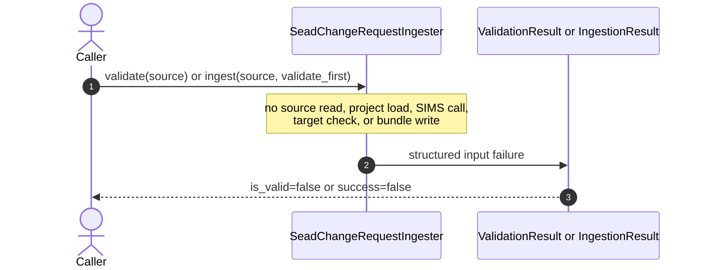
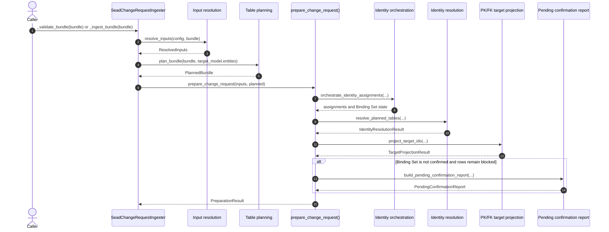
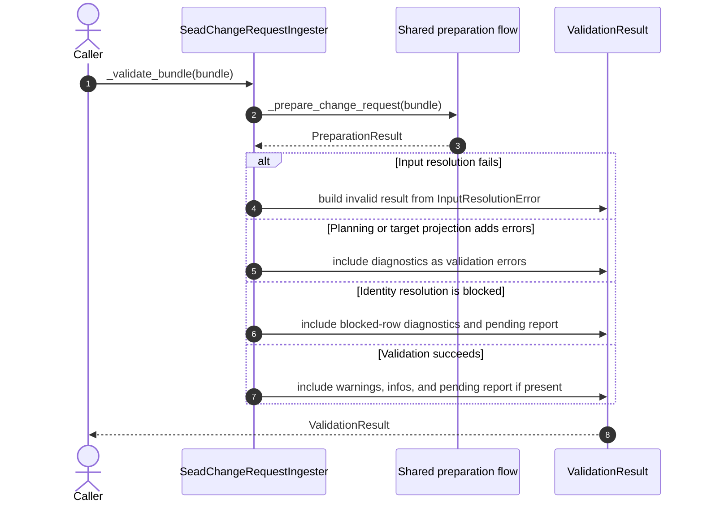
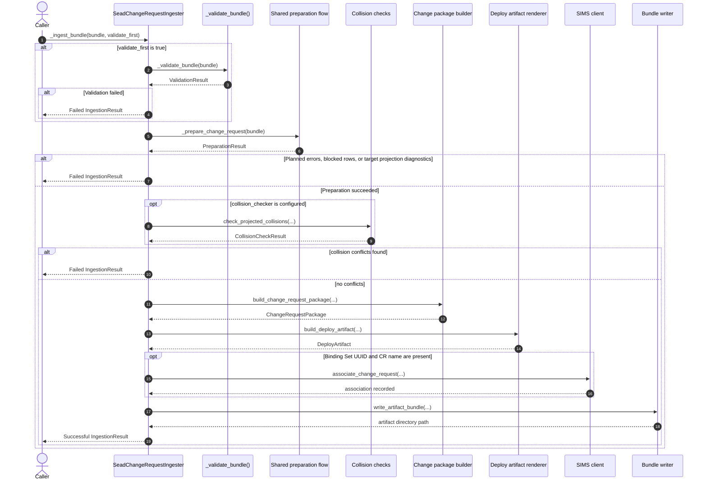

# SEAD Change Request Diagrams

This document gives a high-level view of the core runtime flow in the `sead_change_request` ingester.

The diagrams follow the current implementation in `ingester.py` and `preparation.py`:

- the public `validate()` and `ingest()` methods reject the retired file input before any preparation
- the private `_validate_bundle()` and `_ingest_bundle()` methods reuse the same preparation path
- the preparation path stops after identity resolution and PK/FK target projection
- `_ingest_bundle()` continues with collision checks, package assembly, artifact rendering, and bundle emission

## Retired File Input Flow

This sequence shows the only behavior available through the public protocol methods.

A `Path` or `str` also fails inside the source resolver before `config.extra` is read, so a
path-shaped source cannot select `source_bundle` or `tables`.

## Shared Preparation Flow

This sequence shows the common path reused by both `_validate_bundle()` and `_ingest_bundle()`.

## Validate Flow

This sequence shows how `_validate_bundle()` turns the shared preparation result into a `ValidationResult`.

## Ingest Flow

This sequence shows the full ingestion path after validation has passed.

