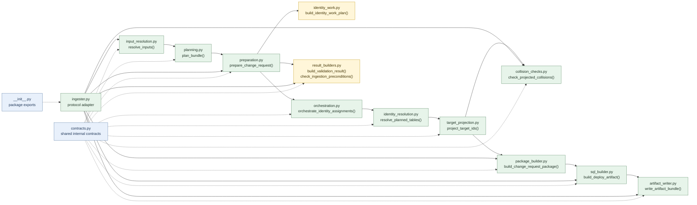

# SEAD Change Request Ingester

This package implements the `sead_change_request` ingester for Shape Shifter.

Its job is to take normalized submission tables, validate them against a target model, resolve the identity work needed for SEAD change requests, and emit a deploy artifact bundle that can be reviewed and executed outside Shape Shifter.

## Overview

This ingester produces deployable change-request artifacts rather than loading rows directly into the live SEAD database.

It does not load rows directly into a live SEAD database. Instead, it prepares a change package and renders that package as a bundle containing deploy SQL, placeholder revert and verify SQL, a manifest, and any payload sidecar files required by the selected deploy strategy.

The Shape Shifter ingester protocol still defines `validate()` and `ingest()`, but their file input is retired:

- `get_metadata()` reports no supported file formats
- `validate()` and `ingest()` return structured input failures before resolving a source, and a `Path` or `str` cannot select tables from `config.extra`
- normalized tables reach the workflow through the public `validate_tables()` and `ingest_tables()` methods
- the package also implements the optional `TableSourceIngester` protocol from `backend.app.ingesters`, so callers can discover table support with a runtime check

`validate_tables()` checks the source bundle, target model, submission context, identity workflow, and target-projection path without emitting a final bundle. `ingest_tables()` runs the same preparation path, then performs collision checks, builds the change package, renders a deploy artifact, and writes the bundle to the configured output folder. Both methods reuse the private `_validate_bundle()` and `_ingest_bundle()` methods after the input adapter runs.

The input adapter deep-copies each supplied DataFrame, sanitizes the copied column labels with `src.utility.sanitize_columns`, and keeps workflow-internal labels (`_`-prefixed or ending in `__existing`) unchanged. Entity names, values, dtypes, and timezone-aware values are preserved. `source_name` is diagnostic metadata only; it is never opened or resolved as a path.

Change Request generation still has no operator entry point. The project-only composition helper and routes are planned follow-up work and are not shipped here.

## Pipeline

The implementation follows this high-level flow:

```text
receive normalized tables in memory through validate_tables() or ingest_tables()
  -> copy each table and sanitize the copied column labels
  -> validate the resolved config inputs
  -> plan each table against the target model
  -> orchestrate identity work via injected clients
  -> project PK/FK values
  -> run optional collision checks
  -> assemble the change package
  -> render the deploy artifact
  -> emit the artifact bundle
```

The shared workflow up to target projection lives in `prepare_change_request()` in [preparation.py](./preparation.py).
Helper result shaping for bundle validation and ingestion lives in [result_builders.py](./result_builders.py).

## Module Dependencies

At a package level, the dependency shape is intentionally simple:

- [contracts.py](./contracts.py) is the shared internal type layer used by most modules
- [ingester.py](./ingester.py) is the protocol adapter and top-level runtime entry point
- [preparation.py](./preparation.py) is the shared workflow hub for the reusable middle of the pipeline
- [__init__.py](./__init__.py) is the package export surface rather than a runtime workflow step

This diagram shows the main workflow-oriented module dependencies without drawing every shared-type import from [contracts.py](./contracts.py):



## Key Concepts

### Resolved Inputs

The public file methods keep their declared file arguments so the shared request and response models stay unchanged, but they reject retired file input. Normalized tables enter through `validate_tables()` and `ingest_tables()`, which accept a `Mapping[str, pd.DataFrame]` plus an optional diagnostic `source_name`.

Inside the package, those inputs are normalized into stable internal contracts defined in [contracts.py](./contracts.py), including:

- `SourceTableBundle`: normalized input tables plus source-level warnings
- `SubmissionContext`: submission metadata used to build the bundle name and SQL headers
- `PlannedTable`: source table plus planned row actions
- `IdentityAssignment` and `IdentityResolutionResult`: resolved per-row identity state
- `TargetProjectionResult`: output-ready tables with target-facing PK/FK values
- `ChangeRequestPackage`: rows selected for insertion into the final change request
- `DeployArtifact`: rendered SQL plus bundle metadata and sidecar files

### Preparation Workflow

`prepare_change_request()` exists to keep the shared workflow out of the protocol adapter.

It prepares:

- resolved inputs
- per-table planning output
- identity orchestration output
- resolved identity tables
- projected tables
- a pending confirmation report when Binding Set confirmation blocks generation

The main ingester still owns protocol-facing concerns such as converting failures into `ValidationResult` or `IngestionResult`, running collision checks, rendering deploy artifacts, and writing files to disk.

### Deploy Strategies

Deploy rendering is separated behind a strategy boundary in [sql_builder.py](./sql_builder.py).

Current strategies:

- `inline_insert`: renders inline `INSERT` statements into the deploy SQL
- `copy_csv`: renders payload sidecar files plus `\copy`-based deploy SQL
- `inline_staging`: stages rows in temporary tables, resolves local foreign keys, and inserts into a named target schema

The ingester resolves the requested strategy from `IngesterConfig.extra["deploy_strategy"]` and passes it into artifact rendering.

All three strategies apply one temporal rule. For a target column declared with type `date`, the rendered literal uses only the normalized calendar date. For a timezone-naive timestamp target, the literal keeps the normalized calendar and clock fields and drops timezone metadata without conversion. An explicitly timezone-aware target type such as `timestamp with time zone` or `timestamptz` fails with a clear `ValueError` before the artifact bundle is written.

## Module Map By Workflow Step

### Foundation And Package Surface

- [contracts.py](./contracts.py): shared internal data structures, enums, bundle naming helpers, and the `PendingConfirmationReport` contract
- [__init__.py](./__init__.py): public package export surface for the main ingester-facing types and helper functions

### Step 1: Resolve Inputs

- [input_resolution.py](./input_resolution.py): resolves in-memory tables, rejects retired file input before reading `config.extra`, validates ingester config inputs, resolves the target model, submission context, fallback identity assignments, and deploy strategy

### Step 2: Plan Work

- [planning.py](./planning.py): plans per-row actions for each source table and assembles `PlannedBundle`
- [identity_work.py](./identity_work.py): groups planned rows into existing, allocation, reconciliation, and bridge work queues

### Step 3: Run The Shared Preparation Path

- [preparation.py](./preparation.py): shared workflow hub used by both private bundle methods
- [orchestration.py](./orchestration.py): thin orchestration over injected SIMS and reconciliation clients
- [identity_resolution.py](./identity_resolution.py): applies identity assignments back onto planned tables
- [target_projection.py](./target_projection.py): rewrites local working IDs into target-facing PK/FK values

### Step 4: Shape Validation And Precondition Results

- [result_builders.py](./result_builders.py): converts preparation output into `ValidationResult` or precondition failures for `IngestionResult`

### Step 5: Finish The Ingestion-Only Path

- [collision_checks.py](./collision_checks.py): optional target-side collision checks before package generation
- [package_builder.py](./package_builder.py): selects insertable rows and builds the in-memory change package
- [sql_builder.py](./sql_builder.py): renders deploy artifacts and strategy-specific payload metadata
- [artifact_writer.py](./artifact_writer.py): writes deploy, revert, verify, manifest, and payload files to disk

### Runtime Entry Point

- [ingester.py](./ingester.py): protocol adapter that rejects the retired file input, coordinates the bundle workflow, converts expected failures into protocol results, and invokes file emission

### Package Documentation

- [DIAGRAMS.md](./DIAGRAMS.md): sequence diagrams for the shared preparation, validation, and ingest flows

## Configuration And Injected Collaborators

The ingester uses `IngesterConfig.extra` for package-specific settings.

Common inputs include:

- `target_model`: required `TargetModel` or raw target-model payload
- `submission_context`: required submission metadata
- `tables` or `source_bundle`: in-memory input tables used by the private bundle methods; the retired public file methods never read them
- `identity_assignments`: optional fallback row assignments
- `deploy_strategy`: optional deploy renderer name or strategy instance
- `trusted_project_context`: required for the API path; the backend supplies it from the
  authorized saved project and the ingester must not take these values from caller input

### Trusted Project Inputs

`trusted_project_context` carries four values the caller cannot set:

- `scope_name`: the registered `provider://<provider-code>/<provider-schema>` scope for the
  saved pair. SIMS requests use this value, so no `sead-change-request:<project>` fallback
  remains and a caller-supplied `sims_scope_name` is rejected.
- `data_provider_id`: the operator-reconciled SEAD provider ID from the project's single
  fixed `data_provider` row. Before any SIMS work, the ingester confirms the ID and the saved
  provider code identify one existing `tbl_data_providers` row. A missing target-database
  connection or an unmatched row blocks the run.
- `business_keys`: the ordered `EntityConfig.keys` per entity. For every tracked project
  entity, the transformed delivery must contain each declared key column with a non-blank,
  unique value. A failure blocks the run before any SIMS request or bundle write.
- `provider_code` and `provider_schema`: the saved pair, used to reject a conflicting nested
  `submission_context`.

Declared keys become one deterministic SIMS business key serialized as
`[1, [[column, type, value], ...]]` in declared order. Entities without declared keys keep the
field-based identity value.

Optional injected collaborators include:

- `sims_client`: allocates entities, derives bridge rows, and manages Binding Set state
- `reconciliation_client`: resolves classifier-like rows to existing target IDs
- `collision_checker`: checks whether rendered rows would collide with target data and reserves configured database-sequence public IDs
- `target_id_allocator`: optional separate client for reserving configured database-sequence public IDs; defaults to `collision_checker`

## Artifact Output

The ingester writes a bundle under `IngesterConfig.output_folder` using the canonical bundle name derived from `SubmissionContext`.

The emitted directory contains:

- `deploy/<bundle_name>.sql`
- `revert/<bundle_name>.sql`
- `verify/<bundle_name>.sql`
- `manifest.json`
- any strategy-specific bundle files such as `deploy/<bundle_name>/*.gz`

The exact payload shape depends on the selected deploy strategy.

The `metadata` and `metadata_artifact` sections both record the effective `scope_name` and
`run_id` used for the run. The ingest response returns the same two values, so an operator can
match an emitted bundle to the SIMS scope and run that produced it.

## Retired File Input

The public protocol methods keep their signatures so the shared request and response models stay
unchanged, but they no longer accept file input.

- `validate(source)` returns `is_valid=False` with an input-retirement error
- `ingest(source, validate_first)` returns `success=False` with the same error for both values of `validate_first`
- `_resolve_source_bundle()` raises `SourceBundleError` for a `Path` or `str` before it reads `config.extra`, so a path-shaped source cannot select `source_bundle` or `tables`

No preparation, SIMS request, target-database call, or bundle write happens for a rejected file
call. Call `validate_tables()` or `ingest_tables()` with a `Mapping[str, pd.DataFrame]` when
normalized tables must be prepared. The private bundle methods remain for callers that already
hold a `SourceTableBundle`.

## Validation Vs Ingestion

The validation and ingestion paths remain separate.

- `validate_tables()` and `_validate_bundle()` report input-resolution failures, planning issues, blocked identity work, and projection problems as structured validation output
- `ingest_tables()` and `_ingest_bundle()` can optionally validate first, then continue into collision checks, package assembly, artifact rendering, and bundle emission

This separation keeps validation side-effect free while allowing ingestion to perform file emission and collaborator callbacks such as change-request association.

The retired public `validate()` and `ingest()` methods do no preparation at all; they return a
structured input failure immediately.

## Testing

The main unit and behavior tests for this package live in `backend/tests/ingesters/`.

Useful commands:

```bash
PYTHONPATH=.:backend pytest backend/tests/ingesters/test_sead_change_request_ingester.py -q
PYTHONPATH=.:backend pytest backend/tests/ingesters/test_sead_change_request_sql_builder.py -q
PYTHONPATH=.:backend pytest backend/tests/ingesters -q
```

## Current Scope

The current implementation prepares and emits change-request artifacts from normalized Shape Shifter output supplied in memory. `validate_tables()` and `ingest_tables()` are the supported entry points; the ingester does not read workbooks, and it has no operator-facing entry point until the project-only composition helper and routes ship.

It is designed to keep business rules around planning, identity resolution, target projection, and deploy rendering explicit and testable, while leaving downstream execution of the generated artifacts outside this package.